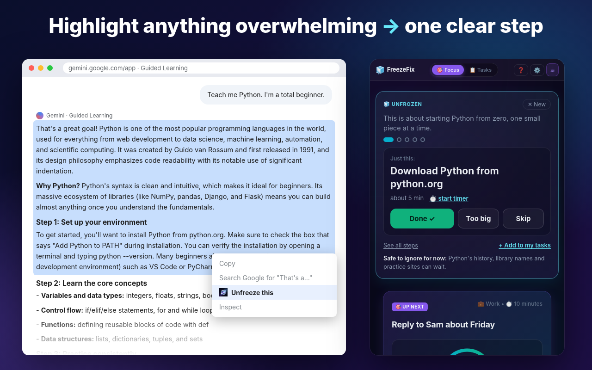

# FreezeFix — Highlight anything overwhelming → one clear step at a time

[](https://ko-fi.com/jmenichole7)

FreezeFix is a Chrome side-panel extension for ADHD brains. Highlight a wall of text (a long Gemini "guided learning" answer, setup instructions, a dense email), right-click **Unfreeze this**, and get a one-line gist plus **one clear step at a time**.



## What it does

- **Unfreeze this** — right-click any selected text, paste into the big box at the top of the panel, or press **Scan this page** (reads your selection, or the page's main text).
- **Gist** — one plain sentence: "This is about…"
- **One step at a time** — only the current step, big and readable, with **Done ✓**, **Too big** (splits just that step into 2–4 smaller ones, in place) and **Skip**. Progress shows as dots, never "3 of 7". **See all steps** if you want the full list, **Add to my tasks** to save what's left.
- **Safe to ignore for now** — one line on what can wait.
- **Calm home** — the panel opens on the Unfreeze box, Up next, a focus timer and a brain dump. Day Flow timeline, auto-schedule, calendar import, streaks and history live under **More**.
- **Works offline** — no key? Built-in rules pull instruction-like lines into steps. Add a free [Groq](https://console.groq.com/keys) or [Gemini](https://aistudio.google.com/apikey) key in ⚙️ Settings for much better results.
- Light/dark themes and an Atkinson Hyperlegible font option. Shortcut: `Alt+Shift+F`.

## Install (unpacked, for development)

1. `git clone https://github.com/jmenichole/FreezeFix && cd FreezeFix && git checkout master`
2. Open `chrome://extensions`, turn on **Developer mode**, click **Load unpacked**, pick the repo folder.
3. Click the FreezeFix toolbar icon (or `Alt+Shift+F`) to open the side panel.

## Build the store zip

```bash
python3 scripts/pack_extension.py
# → dist/FreezeFix-v<version>-ChromeExtension.zip  (+ dist/FreezeFix-ChromeExtension-Unpacked/)
```

Store listing copy, permission justifications and asset list: [`CHROMEWEBSTORE.md`](CHROMEWEBSTORE.md). Screenshots and promo tile: `store-assets/` (regenerate with `node scripts/store-shots/compose.js` after `npm i --no-save playwright@1.49 && npx playwright install chromium`).

## How it's built

| File | Role |
| :--- | :--- |
| `manifest.json` | MV3: side panel, `contextMenus`, `scripting`, `activeTab`, `tabs` |
| `background.js` | "Unfreeze this" context menu → opens the side panel and hands it the selection; screenshot bridge |
| `index.html`, `style.css` | Side panel UI |
| `js/unfreeze-core.js` | Strict JSON prompts, JSON validation/repair, offline splitter (pure, testable in Node) |
| `js/unfreeze.js` | Unfreeze box, page-text scan, one-step-at-a-time UI |
| `js/ai.js` | Gemini / Groq calls (bring your own key), `unfreezeText`, `splitStep`, `unfreezeImage` |
| `js/app.js`, `js/tasks.js`, … | Tasks, Up next, focus timer, brain dump, Day Flow, settings |

## Privacy

Text is read only when you click and is sent only to the AI provider whose key you added; with no key everything runs locally. Nothing is stored on any FreezeFix server. See [`PRIVACY.md`](PRIVACY.md).

Record every change in [`CHANGELOG.md`](CHANGELOG.md).

---

## Legacy desktop build (Electron)

The original desktop widget (`main.js`, `tracker.py`, `package.json`) still lives in this repo. It is not part of the Chrome extension zip.

### Desktop quick start
- Run in dev: `npm install` then `npm start`
- Build a Windows installer: `npm run build` (electron-builder produces the NSIS installer in `dist/`)

### Release & auto-updates
FreezeFix uses `electron-updater` with GitHub Releases as the update provider.

1. Create the GitHub repo: `jmenichole/FreezeFix` and push code.
2. Create a PAT (Personal Access Token) with `repo` scope and set `GH_TOKEN` in your environment or CI secrets for publishing.
3. Tag a release or use electron-builder to publish:
   - `electron-builder --publish=always`

When a new release is published (attach the installer `.exe`), the app checks GitHub Releases on startup, downloads updates in the background, and prompts users to "Restart and install" when ready.

### Packaging for customers (Gumroad)
Ship only the installer `.exe` to customers (do not ship full `dist/` or source files). Recommended customer package:

```
FreezeFix-v1.0.0/
├── FreezeFix Setup 1.0.0.exe
├── README.txt
└── LICENSE
```

### GitHub Pages
A simple marketing site is included in `docs/`. To publish it as GitHub Pages:
1. Push the repo to GitHub.
2. In repository settings → Pages, select `Branch: main` and `Folder: /docs` (or `gh-pages` branch if you prefer).
3. The site will be served at `https://<youruser>.github.io/FreezeFix/` (copy the URL from settings).

### Security & licensing
This project is proprietary. See LICENSE for All Rights Reserved text. Do not redistribute without explicit permission.

### Optional screen vision (desktop, Python)
The "Scan Screen" / Vision feature relies on the local `tracker.py` sidecar, which needs:
- **Python 3** available on the user's machine (the app tries `python`, then `python3`).
- The **Pillow** package for screen capture: `pip install Pillow`.

This is entirely optional. The rest of FreezeFix (tasks, timeline, timer, breakdowns,
calendar import, AI text suggestions) works without Python. If Python/Pillow is missing
or the tracker isn't running, the app degrades gracefully and shows guidance instead of
failing. For security, the tracker binds to `127.0.0.1`, rejects non-app (website)
origins, and requires a per-session token supplied by the app on sensitive endpoints.

### Desktop developer notes
- The app spawns a local `tracker.py` process for optional screen-capture features. If you disable screen capture in Settings, the tracker will not be launched automatically.
- API keys (Gemini/Groq) are stored in localStorage by the UI. Advise users to keep keys private.
- App icons live in `build/` (`icon.ico`/`icon.png`), generated by `build/generate_icon.py` (needs Pillow; build-time only).
- Record every change in [`CHANGELOG.md`](CHANGELOG.md) — note what changed, who made it, and when (`YYYY-MM-DD`). See the "How to maintain this changelog" section there.

### Marketing site (docs)
The `docs/` site contains a lightweight, responsive landing page. Edit `docs/index.html` to update marketing copy or point the buy button to your Gumroad product URL.


## Support & contact
Author: jmenichole · j.chapman7@yahoo.com · https://github.com/jmenichole · [Ko-fi](https://ko-fi.com/jmenichole7)
